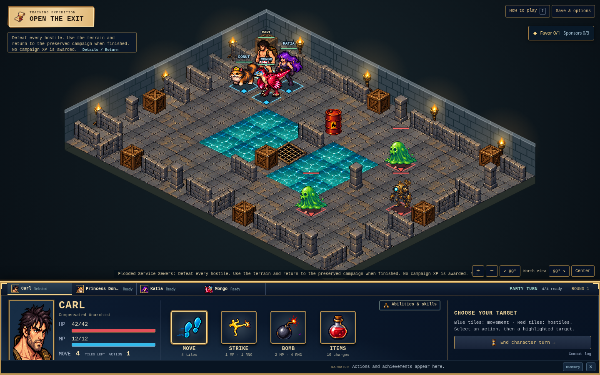
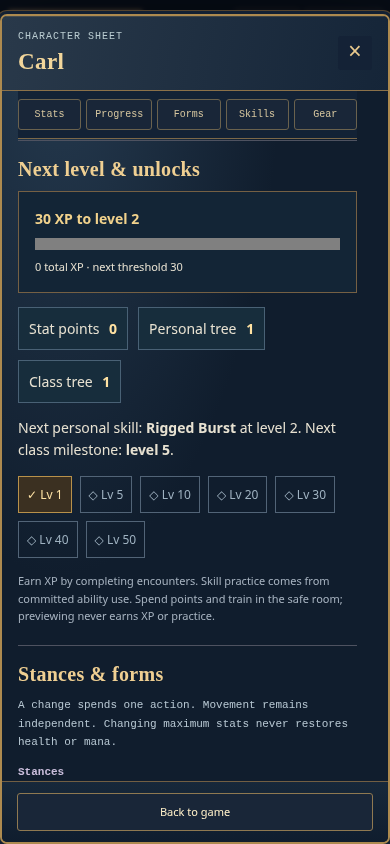
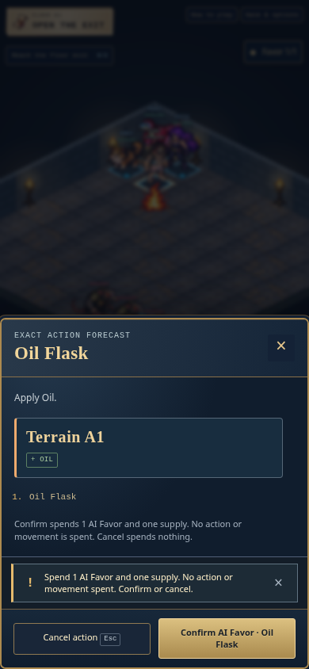
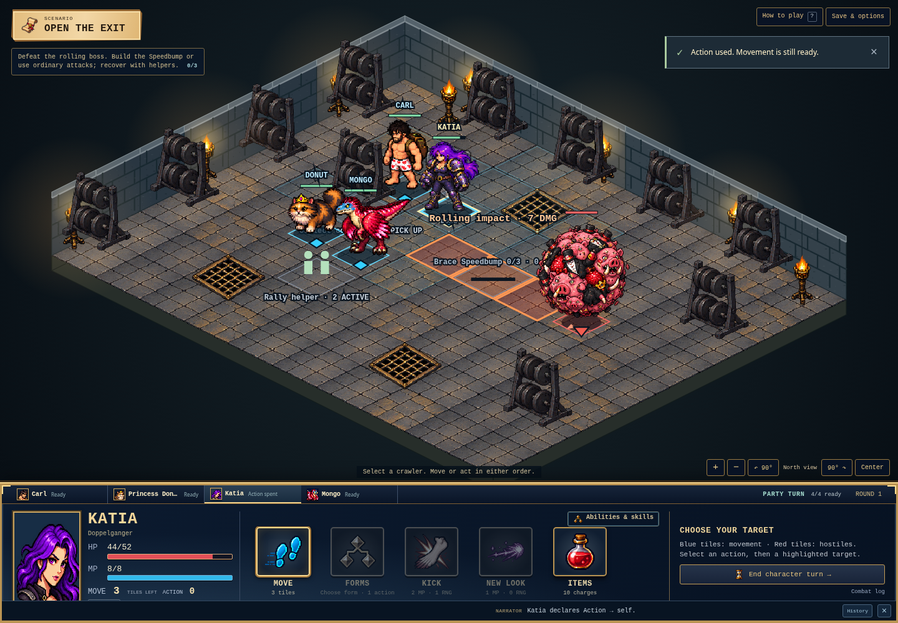

# Visual and gameplay release QA

Tested against the local Release WebAssembly build of this change using installed Chromium and Playwright. Desktop: **1440×900**. Phone layout: **390×844**. Reproduce after publish with `python3 Tools/playtest_finish.py --url http://localhost:5188 --screenshots /tmp/dct-finish-qa`. This is browser emulation, not a physical phone or Unity Editor run.

- [x] Both safe-room trap recipes: preview, cancellation, confirmed inventory changes. A legally crafted Shock Snare is placed and triggered by Donut: exactly 5 HP lost, Shocked applied, tile consumed.
- [x] Legal exploration into battle; four rotations and screen/cell picking roundtrips.
- [x] Action chooser, detailed exact forecast, cancellation, commitment and movement after acting.
- [x] Carl → Donut → Katia → Mongo before enemy movement and the next round.
- [x] Baseline and three alternate forms available; actual form changes separately verified against generated sprites.
- [x] Earn Favor through a real reaction on a room imported through the UI; saved sponsor receipt.
- [x] Favor utility available after action spent; cancellation unchanged, confirmation consumes one Favor and one supply, movement/action budgets preserved.
- [x] Save reload preserves committed state in every lane.
- [x] No horizontal overflow or JavaScript errors in any lane.
- [x] Character Progress tab, enlarged strike icon, equipment, skills and navy/gold menu styling reviewed at desktop/phone sizes.
- [x] Desktop advisor overlap fixed and specifically rechecked.
- [x] Toast placement corrected below the Favor badge at both widths (108px desktop, 94px phone).
- [x] A saved checkpoint from the previously deployed Lantern Row build imports with existing XP, supplies and choices preserved.
- [ ] Full human balance/enjoyment study and end-to-end manual story run.
- [ ] Exact image-reference parity and native Unity presentation parity.

## Actual captures

These are actual runtime captures, separate from the generated concept/menu illustrations. Full temporary QA output is `/tmp/dct-finish-qa/results.json`; only representative captures are included in the repository. Source edits after captures were limited to the specifically rechecked camp/welcome correction and documentation.
